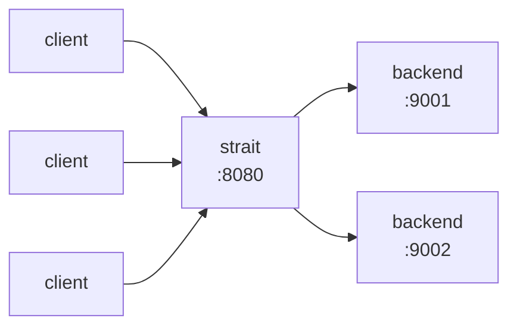
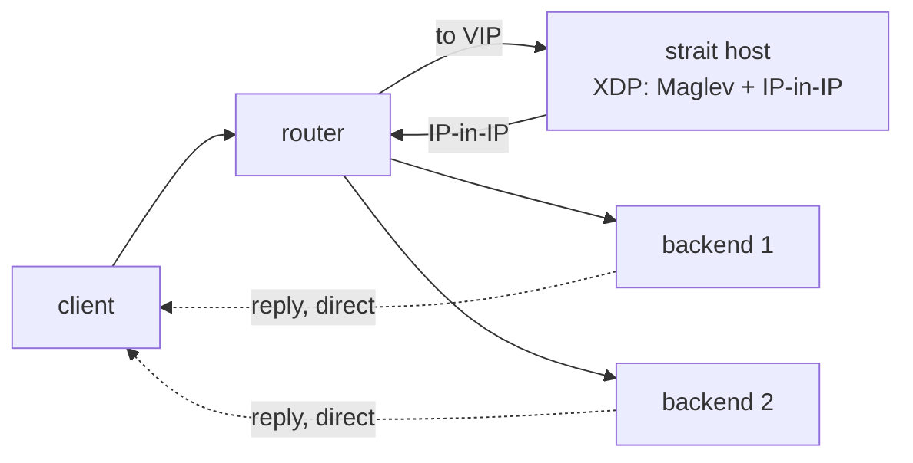

# strait

**strait** — every connection passes through.

A Layer 4 load balancer written in Rust, with health checks, Prometheus metrics, Kubernetes service discovery and an experimental eBPF/XDP data plane.

> Work in progress. strait is being built in stages, from a plain TCP proxy up to an XDP data plane. See the [roadmap](#roadmap) for what works today.

## How it works



For every incoming connection, strait picks a backend using the configured strategy, then relays bytes in both directions on its own lightweight [tokio](https://tokio.rs) task until either side closes. If a backend is unreachable, only that connection fails; the proxy keeps accepting new ones.

### Strategies

| Strategy | Flag | Behavior |
|---|---|---|
| Round-robin | `--strategy round-robin` (default) | Sends each new connection to the next backend in order. |
| Least connections | `--strategy least-conn` | Sends each new connection to the backend with the fewest open connections. Best when connections are long-lived or uneven. |
| IP hash | `--strategy ip-hash` | Keeps every connection from the same client IP on the same backend (session affinity). |

Each backend tracks its open connections with an atomic counter. The counter is released automatically when a connection ends, including when it ends with an error.

### Session affinity

`ip-hash` uses [rendezvous hashing](https://en.wikipedia.org/wiki/Rendezvous_hashing): every backend gets a score from `hash(client ip, backend address)` and the highest score wins. The same client always gets the same backend, and when a backend leaves the rotation only the clients it was serving move; everyone else stays where they are. A plain `hash(ip) % backends` would move almost every client instead.

Things to keep in mind:

- strait works at Layer 4, so the client IP is the only identity it sees. Clients behind the same NAT or proxy share an IP and therefore a backend.
- Affinity gives way to health: if a client's backend is unhealthy, the client goes to the next best backend and returns once its backend is healthy again.
- Scores use Rust's `DefaultHasher`, which is stable within a build. Two strait instances running the same binary agree on every assignment.

### Failure handling

strait keeps clients away from broken backends in three ways:

- **Active health checks.** Every backend is probed with a TCP connection every `--health-interval`. After 2 consecutive failures it leaves the rotation; after 2 consecutive successes it comes back. If every backend is unhealthy, strait fails open and keeps trying all of them, since a broken health check should not take the whole service down.
- **Retries.** If connecting to the chosen backend fails or takes longer than `--connect-timeout`, strait tries up to `--retries` other backends before giving up. This covers the window between a backend going down and the health check noticing.
- **Idle timeout.** Connections with no traffic in either direction for `--idle-timeout` are closed, so stuck clients do not hold backend connections forever. This includes a client that stops reading: once its socket buffer is full and no byte moves, the timeout fires. Each direction is copied independently, so one side stalling never blocks the other, and TCP half-close is preserved: when one side finishes sending, the other direction keeps flowing.

### Shutdown

On `SIGTERM` (how Kubernetes stops a pod) or Ctrl-C, strait closes its listeners and waits up to `--shutdown-timeout` (default `20s`) for open connections to finish, then cuts the rest and exits. A second signal skips the wait.

## Quick start

Requires Rust 1.95 or later.

```bash
git clone git@github.com:kevinfinalboss/strait.git
cd strait
cargo build --release
```

Start two backends, then put strait in front of them:

```bash
# terminals 1 and 2: any TCP service works; these serve HTTP
python3 -m http.server 9001 --bind 127.0.0.1
python3 -m http.server 9002 --bind 127.0.0.1

# terminal 3
./target/release/strait -b 127.0.0.1:9001 -b 127.0.0.1:9002

# terminal 4: requests alternate between the two backends
curl http://127.0.0.1:8080/
```

strait logs listeners, health changes, reloads and failures. Stop one of the backends and the health check takes it out of rotation; start it again and it comes back:

```
WARN strait: backend refused connection backend=127.0.0.1:9001 error=Connection refused (os error 111)
WARN strait::health: backend is unhealthy, removed from rotation backend=127.0.0.1:9001
INFO strait::health: backend is healthy again backend=127.0.0.1:9001
```

Successful connections are logged at debug level only, since a line per connection costs more than the proxying itself under load; [metrics](#metrics) cover the totals. Set `RUST_LOG=strait=debug` to see every connection, with the backend it went to and the bytes sent and received:

```
DEBUG strait: connection opened peer=127.0.0.1:42030 backend=127.0.0.1:9001
DEBUG strait: connection closed peer=127.0.0.1:42030 backend=127.0.0.1:9001 sent=78 received=621
```

## Configuration

For more than one listener, or to change backends without a restart, use a YAML file:

```yaml
listeners:
  - name: web
    listen: 0.0.0.0:8080
    strategy: least-conn
    backends:
      - 10.0.0.1:9001
      - 10.0.0.2:9001

  - name: cache
    listen: 0.0.0.0:6380
    strategy: ip-hash
    backends:
      - 10.0.1.1:6379
```

```bash
strait --config strait.yaml
```

Only `name`, `listen` and `backends` are required. [`strait.example.yaml`](strait.example.yaml) lists every field with its default. The file is checked strictly: an unknown field, a duplicate listener, an empty backend list or a zero timeout is rejected with the field and line that caused it:

```
Error: invalid config strait.yaml

Caused by:
    listeners[0]: unknown field `retires`, expected one of `name`, `listen`, `backends`, `strategy`, `connect_timeout`, `idle_timeout`, `retries`, `health_check` at line 5 column 5
```

### Reloading

Edit the file and send `SIGHUP` to apply it without a restart:

```bash
kill -HUP $(pidof strait)
```

```
INFO strait: config reloaded summary=added: admin; updated: web
```

- **Open connections are never dropped.** Each connection keeps the backend pool it started with; new connections use the new one.
- **Listeners are matched by `listen` address.** A listener whose address stays is updated in place (new backends, strategy or timeouts, same socket); a new address is bound; a removed one stops accepting while its open connections finish.
- **Backends that stay keep their state**, so health status and least-conn counters carry over instead of starting fresh.
- **A bad reload changes nothing.** strait validates the whole file and binds every new address before applying anything. If any step fails, it logs the reason and keeps running the previous config.

To reload whenever the file changes, add `--watch-config`. strait watches the file's directory rather than the file itself, which is how a mounted Kubernetes ConfigMap gets updated: the kubelet swaps a `..data` symlink, and a watch on the file alone would miss it.

Flags still work for a single listener, as in the quick start. `--config` and `--backend` cannot be combined.

## Kubernetes

A listener can take its backends from a Kubernetes Service instead of a fixed list:

```yaml
listeners:
  - name: web
    listen: 0.0.0.0:8080
    kubernetes:
      service: web       # ready pods of this Service become backends
      namespace: shop    # optional; defaults to the namespace strait runs in
      port: http         # port name from the Service, or the container port number
```

strait watches the Service's [EndpointSlices](https://kubernetes.io/docs/concepts/services-networking/endpoint-slices/) through the API server and updates the backend pool on every change, the same source kube-proxy uses:

- **Only ready endpoints are backends.** A pod that fails its readiness probe or starts terminating leaves the rotation as soon as Kubernetes marks it not ready.
- **Pods that stay keep their state** across updates: health status, least-conn counters and `ip-hash` assignments carry over.
- **An empty Service is fine.** With no ready pods, new connections fail fast with `no_backend` and the listener recovers when pods come back.
- **Credentials come from the environment**: the pod's ServiceAccount in a cluster, or the current kubeconfig context outside one. strait needs `get`, `list` and `watch` on `endpointslices` in the `discovery.k8s.io` group.

Removing a pod mid-request still cuts the connections it was serving; no L4 proxy can move an open TCP connection. Give backends a short `preStop` sleep so strait drops them from rotation before they stop, as in [`demo/kubernetes/web.yaml`](demo/kubernetes/web.yaml).

### Helm chart

[`deploy/helm/strait`](deploy/helm/strait) runs strait with its config in a ConfigMap, a Service with one port per listener, and RBAC limited to reading EndpointSlices:

```bash
helm install strait deploy/helm/strait \
  --set 'config.listeners[0].name=web' \
  --set 'config.listeners[0].listen=0.0.0.0:8080' \
  --set 'config.listeners[0].kubernetes.service=web' \
  --set 'config.listeners[0].kubernetes.port=http'
```

The whole strait config goes under `config` in the values, in the same format as the YAML file. With `watchConfig: true` (the default) a `helm upgrade` that changes the config is applied by the running pods, without a restart, once the kubelet syncs the ConfigMap (usually within a minute). Other values:

| Value | Default | Meaning |
|---|---|---|
| `config` | one listener for Service `web` | strait config, rendered into the ConfigMap |
| `watchConfig` | `true` | Apply config changes live; when `false`, a change rolls the pods |
| `rbac.clusterWide` | `false` | Use a ClusterRole so listeners can watch Services in other namespaces |
| `serviceMonitor.enabled` | `false` | Create a Prometheus Operator ServiceMonitor for the metrics port |
| `shutdown.preStopSleepSeconds` | `5` | Keep accepting while the pod leaves the Service endpoints (Kubernetes 1.30+; `0` disables) |
| `shutdown.drainTimeout` | `20s` | Time open connections get to finish after `SIGTERM` |
| `shutdown.terminationGracePeriodSeconds` | `30` | Must cover the preStop sleep plus the drain timeout |
| `image.repository`, `image.tag` | `ghcr.io/kevinfinalboss/strait`, chart `appVersion` | Container image |

The chart refuses to render a listener that watches another namespace without `rbac.clusterWide`, instead of deploying a pod that would fail with a permission error. Pods run as a non-root user with a read-only root filesystem and no Linux capabilities.

### Container image

The [`Dockerfile`](Dockerfile) builds a 42 MB image on [distroless](https://github.com/GoogleContainerTools/distroless): no shell or package manager, running as UID 65532.

```bash
docker build -t strait .
```

### Try it on kind

[`demo/kubernetes.sh`](demo/kubernetes.sh) creates a [kind](https://kind.sigs.k8s.io) cluster, installs the chart in front of a Deployment that answers with its pod name, and scales it from 3 to 5, down to 1 and back to 3 while traffic flows:

```
requests  33828  (967/s)
errors    0
latency   p50 10.2ms  p95 13.2ms  p99 15.2ms

second     4jgb7   f6rkr   l7kr6   vqbvn   w4w5z   wj6ml   zpw9d  errors
    14         0       0     199     199     199     199     199       0
    15         0       0      56      54      56     742      56       0
    16         0       0       0       0       0     953       0       0
```

Each column is a pod; at second 15 four of the five pods leave and their traffic moves to the one that stays, with no errors.

## XDP data plane

> Experimental. Linux only, IPv4 and TCP only, and not yet benchmarked against the proxy.

With `dataplane: xdp`, a listener stops being a proxy. strait loads an [XDP](https://docs.kernel.org/networking/af_xdp.html) program, written in Rust with [Aya](https://aya-rs.dev), onto a network interface. The program balances packets in the driver, before the kernel allocates anything for them:



1. A packet to the VIP (the listener's `listen` address) reaches the strait host.
2. The program hashes the flow's 5-tuple and looks up its backend in the VIP's [Maglev](https://research.google/pubs/maglev-a-fast-and-reliable-software-network-load-balancer/) table.
3. It wraps the packet in an outer IPv4 header addressed to that backend (IP-in-IP), points it at the gateway and sends it back out of the same interface (`XDP_TX`).
4. The backend unwraps it and answers the client directly (direct server return). Replies never pass through strait, which only ever sees the client's side of each flow.

There is no connection tracking. A flow stays on its backend because its hash and the table stay the same. Maglev keeps changes small: when a backend joins or leaves, only a few percent of other flows move, against nearly all of them with `hash % backends`.

The control plane is the same as for the proxy. Static or Kubernetes backends, health checks and the `strait_backend_*` gauges all work unchanged. Every 500ms, strait compares each XDP listener's healthy backends with its table and rewrites only the slots that changed.

### Configuration

```yaml
xdp:
  interface: eth0              # where VIP traffic arrives
  source: 10.0.2.2             # outer source address, usually the interface's own
  gateway_mac: "aa:bb:cc:dd:ee:ff"  # next hop that routes to the backends
  mode: auto                   # auto | native | generic

listeners:
  - name: web
    listen: 10.0.0.10:80       # the VIP; not bound to a socket
    dataplane: xdp
    backends: [10.0.3.2:80, 10.0.3.3:80]   # same port as the VIP
```

Backends need the VIP on a local interface and an IP-in-IP tunnel that accepts packets from any source:

```bash
ip addr add 10.0.0.10/32 dev lo
ip tunnel add ipip0 mode ipip local <backend ip> && ip link set ipip0 up
sysctl -w net.ipv4.conf.all.rp_filter=0 net.ipv4.conf.ipip0.rp_filter=0
```

Things to know:

- **Root required.** strait needs root, or `CAP_BPF` and `CAP_NET_ADMIN`, to load the program.
- **Room for the outer header.** Encapsulation adds 20 bytes, so links between strait and the backends need an MTU 20 bytes larger than the clients' (or clients need a smaller MSS).
- **Changing the `xdp` section needs a restart.** Listeners can be added, changed and removed with a reload, like proxy listeners. Up to 16 XDP listeners.
- **Prometheus counters.** `strait_xdp_packets_total`, `strait_xdp_bytes_total` and `strait_xdp_no_backend_total` count per listener what the program forwarded or dropped.

### Building

The feature is off by default, so a plain build needs neither nightly nor BPF tools:

```bash
rustup toolchain install nightly --component rust-src
# bpf-linker: prebuilt binary from https://github.com/aya-rs/bpf-linker/releases
cargo build --release --features xdp
```

The build script compiles [`strait-ebpf`](strait-ebpf/src/main.rs) for the BPF target and embeds it in the binary. Types shared by both sides live in [`strait-common`](strait-common/src/lib.rs), and the table is built in [`src/maglev.rs`](src/maglev.rs).

### Try it

[`demo/xdp.sh`](demo/xdp.sh) builds a client, a router, strait and two backends in network namespaces, sends requests to the VIP, stops a backend and shows the counters. It needs sudo:

```
$ demo/xdp.sh
== 20 requests to the VIP; each new connection is a new flow
     10 b1
     10 b2

== b1 goes down; the health check takes it out of every table
     10 b2

== the load balancer never sees a reply: it only counts client packets
strait_xdp_packets_total{listener="web"} 210
strait_xdp_no_backend_total{listener="web"} 0
```

The demo needs two workarounds that real network cards do not, both specific to veth pairs:

- **An XDP program on the router's end of the link** ([`examples/xdp_pass.rs`](examples/xdp_pass.rs)). A veth delivers frames sent with `XDP_TX` only if its peer runs XDP too.
- **Client checksums computed in software.** veth leaves TCP checksums to be filled in later and marks the packet instead. Native XDP loses that mark, so backends would see bad checksums.

## Metrics

Enable the Prometheus endpoint with `--metrics 127.0.0.1:9090` or in the config file:

```yaml
metrics:
  listen: 127.0.0.1:9090
```

It serves `/metrics` in the Prometheus text format and `/healthz` for liveness probes.

| Metric | Type | Labels | Meaning |
|---|---|---|---|
| `strait_connections_accepted_total` | counter | `listener` | Client connections accepted |
| `strait_backend_connections_total` | counter | `listener`, `backend` | Connections established to a backend |
| `strait_backend_connect_failures_total` | counter | `listener`, `backend`, `reason` | Failed connects (`refused`, `timeout`), retried ones included |
| `strait_connection_errors_total` | counter | `listener`, `reason` | Client connections that failed (`no_backend`, `relay`) |
| `strait_bytes_total` | counter | `listener`, `backend`, `direction` | Bytes relayed; `sent` is client to backend, `received` is backend to client |
| `strait_backend_connect_duration_seconds` | histogram | `listener`, `backend` | Time to open a TCP connection to a backend |
| `strait_connection_duration_seconds` | histogram | `listener`, `backend` | Lifetime of relayed connections |
| `strait_backend_active_connections` | gauge | `listener`, `backend` | Connections open right now |
| `strait_backend_up` | gauge | `listener`, `backend` | `1` if the backend passes health checks |
| `strait_config_reloads_total` | counter | `result` | Reloads by `success` or `failure` |

A few details:

- **Bytes are counted as they move**, not when a connection closes, so long-lived connections show up while they are open.
- **The two gauges are read at scrape time** from the live backend pools. A backend removed by a reload disappears from them instead of keeping its last value.
- **Series of removed backends are dropped.** When a backend leaves a listener (a reload, or a pod going away in Kubernetes), its counters and histograms leave `/metrics` as soon as its last open connection closes, so pod IP churn does not grow the number of series forever. The same goes for the series of a listener removed or renamed by a reload.
- **Metrics cost nothing measurable.** On the benchmark above, throughput and CPU per request with metrics enabled stayed within run-to-run noise.

Useful queries:

```promql
# Requests per second per backend
sum by (backend) (rate(strait_backend_connections_total[1m]))

# Share of connections that failed
sum(rate(strait_connection_errors_total[5m])) / sum(rate(strait_connections_accepted_total[5m]))

# p99 time to connect to each backend
histogram_quantile(0.99, sum by (le, backend) (rate(strait_backend_connect_duration_seconds_bucket[5m])))

# Backends out of rotation
strait_backend_up == 0
```

The metrics address is read at startup; changing it in the config needs a restart.

## Demos

[`demo/`](demo) has scenarios that run strait in front of three local backends under load: even balancing, a slow replica with least-conn, a backend failing and recovering mid-traffic, session affinity across 40 client IPs, and a config reload that swaps backends mid-traffic with zero errors. [`demo/kubernetes.sh`](demo/kubernetes.sh) does the same on kind, scaling pods under load (see [Kubernetes](#try-it-on-kind)).

```bash
demo/run.sh
```

See [`demo/README.md`](demo/README.md) for what each scenario shows.

## Performance

[`demo/bench.sh`](demo/bench.sh) runs [oha](https://github.com/hatoo/oha) against a minimal Rust HTTP backend, once directly and once through strait, so the difference is the cost of strait itself. Baseline for the current userspace proxy, 50 connections for 10s on an AMD Ryzen 7 5700G under WSL2, with the load generator, strait and the backend sharing the same machine:

| Run | Requests/s | p50 | p99 | CPU/request |
|---|---|---|---|---|
| keep-alive, direct | 145,130 | 0.27 ms | 1.41 ms | 30.2 µs |
| keep-alive, via strait | 80,281 | 0.53 ms | 1.98 ms | 49.8 µs |
| new connection per request, direct | 50,300 | 0.83 ms | 2.99 ms | 75.5 µs |
| new connection per request, via strait | 20,124 | 2.29 ms | 5.72 ms | 272.4 µs |

CPU/request is the backend's own CPU time on direct runs and strait's on runs through strait. It is a steadier metric than requests per second when other processes compete for the CPU.

What the numbers say:

- **strait costs about twice a minimal server.** A keep-alive request makes the backend do one read and one write; strait does two of each, one per side. With a new connection per request strait also opens a TCP connection to the backend. This is the floor for a proxy that copies bytes through userspace, and it is what the eBPF/XDP stage will be measured against.
- **Absolute numbers are inflated by WSL2.** Even the minimal backend spends about 30 µs of CPU per request, because every syscall goes through the virtual machine. On bare-metal Linux the same work is several times cheaper.
- **TCP_NODELAY matters for split responses.** Without it, a backend that sends headers and body in separate writes hit Nagle's algorithm inside strait: the body waited for the client's delayed ACK, adding about 40 ms. On one keep-alive connection, enabling it took p99 from 43 ms to 0.5 ms and throughput up 4.8x. [`tests/proxy.rs`](tests/proxy.rs) guards against regressions.

## Usage

```
strait [OPTIONS]

Options:
  -c, --config <FILE>                    YAML config file; send SIGHUP to reload it without dropping connections
  -l, --listen <LISTEN>                  Address to listen on [default: 127.0.0.1:8080]
  -b, --backend <BACKENDS>               Backend that receives connections (repeat for more backends)
  -s, --strategy <STRATEGY>              Load balancing strategy [default: round-robin] [possible values: round-robin, least-conn, ip-hash]
      --connect-timeout <DURATION>       Maximum time to connect to a backend [default: 3s]
      --idle-timeout <DURATION>          Close connections with no traffic for this long [default: 5m]
      --retries <RETRIES>                Other backends to try when a connection to the chosen one fails [default: 2]
      --health-interval <DURATION>       Time between health checks of each backend [default: 5s]
      --health-timeout <DURATION>        Maximum time a health check may take [default: 1s]
      --watch-config                     Reload automatically when the config file changes, including a mounted ConfigMap
      --metrics <ADDR>                   Serve Prometheus metrics on this address (overrides metrics.listen in the config)
      --shutdown-timeout <DURATION>      On SIGTERM or Ctrl-C, how long open connections get to finish [default: 20s]
  -h, --help                             Print help
  -V, --version                          Print version
```

Durations accept values such as `500ms`, `3s`, `5m` or `1h`.

## Development

```bash
cargo test                                   # unit and integration tests
cargo clippy --all-targets -- -D warnings    # lint
cargo fmt                                    # format
```

- [`src/balancer.rs`](src/balancer.rs) has unit tests for each strategy, connection tracking and how `ip-hash` spreads and moves clients.
- [`tests/proxy.rs`](tests/proxy.rs) checks round trips, 50 concurrent clients, and that a dead backend does not take the proxy down.
- [`tests/balancing.rs`](tests/balancing.rs) runs strait in front of several backends and checks how connections are spread, including `ip-hash` from 20 different source IPs.
- [`tests/resilience.rs`](tests/resilience.rs) covers retries, health checks taking a backend out and back in, and idle timeouts.
- [`src/config.rs`](src/config.rs) has unit tests for parsing, defaults and every validation rule.
- [`tests/metrics.rs`](tests/metrics.rs) scrapes the endpoint and checks connection, byte and failure counters, live gauges, and that backends removed by a reload leave the gauges.
- [`tests/reload.rs`](tests/reload.rs) covers multiple listeners and reloads: switching backends with a connection open, adding and removing listeners, and a failed reload leaving everything as it was.
- [`src/discovery.rs`](src/discovery.rs) has unit tests for turning EndpointSlices into backends: readiness, named and numeric ports, multiple slices, IPv6.
- [`src/maglev.rs`](src/maglev.rs) checks that Maglev shares differ by at most one slot, ignore backend order, and move few flows when a backend joins or leaves.
- [`demo/xdp.sh`](demo/xdp.sh) is the end-to-end check of the XDP data plane (needs sudo).
- [`tests/kubernetes.rs`](tests/kubernetes.rs) runs discovery against a real cluster by creating EndpointSlices directly. It is skipped by default; run it with a kind cluster:

  ```bash
  kind create cluster
  cargo test --test kubernetes -- --ignored
  ```

## Roadmap

- [x] **TCP proxy**: one backend, bidirectional copy, graceful shutdown
- [x] **Load balancing**: multiple backends, round-robin and least-connections
- [x] **Health checks**: unhealthy backends leave the rotation automatically, with connection retries and timeouts
- [x] **Session affinity**: `ip-hash` strategy that keeps each client on the same backend using rendezvous hashing, so adding or removing a backend only moves that backend's clients
- [x] **Config file**: YAML configuration with multiple listeners and hot reload on `SIGHUP`
- [x] **Metrics**: Prometheus endpoint
- [ ] **Dashboards**: Grafana dashboard and a docker compose stack with Prometheus
- [x] **Kubernetes**: discover backends from a Service's EndpointSlices, reload automatically when a mounted ConfigMap changes, Helm chart
- [ ] **eBPF/XDP**: in-kernel data plane with [Aya](https://aya-rs.dev) and Maglev consistent hashing, benchmarked against the userspace proxy. *The [data plane](#xdp-data-plane) works; the benchmark is next.*

## License

[MIT](LICENSE)
